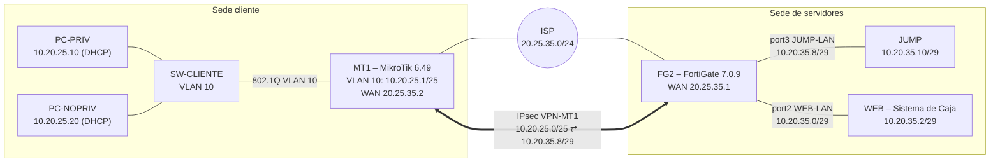

# P3 – Infraestructura 2: VPN Remote-Site con acceso exclusivo al Jump Server

**Estudiante:** Gregorys Morel Duluc · **Matrícula:** 2025-0035 · **Materia:** Seguridad de Redes (ITLA)

## 🎥 Video demostrativo

**[▶ Ver video en YouTube](https://www.youtube.com/watch?v=QMmQwn7TbSA)**

---

## 1. Propósito del laboratorio

El propósito de este laboratorio es conectar una sede cliente con la sede de servidores mediante una **VPN IPsec Remote-Site** a través de un ISP con direcciones públicas, aplicando el modelo de **Jump Server** (bastión). La VPN no expone la red de servidores: el túnel **solo da acceso al Jump Server**, y únicamente el Jump Server puede llegar al Web Server, y solo por **HTTPS, RDP y SSH**. Los usuarios de la sede cliente se separan por privilegios: el usuario **sin privilegios** solo puede usar el servicio web publicado en el Jump Server y tiene SSH bloqueado explícitamente, mientras que el usuario **con privilegios** puede usar Web, SSH (PuTTY) y RDP hacia el Jump Server. Toda la configuración y la demostración del FortiGate se realizó por GUI.

---

## 2. Topología




---

## 3. Direccionamiento (basado en la matrícula 2025-0035)

| Red | Segmento | Gateway | Asignación |
|---|---|---|---|
| ISP (IP públicas) | **20.25.35**.0/24 | — | FG2 .1 · MT1 .2 |
| Usuarios VLAN 10 (/25) | 10.**20.25**.0/25 | 10.20.25.1 (MT1) | DHCP; reservas .10 y .20 |
| WEB-LAN (/29) | 10.20.**35**.0/29 | 10.20.35.1 (FG2) | WEB 10.20.35.2 |
| JUMP-LAN (/29) | 10.20.**35**.8/29 | 10.20.35.9 (FG2) | JUMP 10.20.35.10 |
| Gestión | 192.168.56.0/24 | — | FG2 192.168.56.52 |

| Usuario | MAC | IP reservada |
|---|---|---|
| PC-PRIV (con privilegios) | 02:42:A7:23:FB:00 | 10.20.25.10 |
| PC-NOPRIV (sin privilegios) | 02:42:6D:FF:7C:00 | 10.20.25.20 |

---

## 4. Requisitos y evidencia

| # | Requisito del enunciado | Cómo se cumple | Evidencia |
|---|---|---|---|
| 1 | FortiGate: toda configuración y demostración por GUI | Interfaces, VPN, ruta, objetos y políticas en el GUI | img/I2-01 a I2-05 |
| 2 | Equipo de red con configuración de red | MikroTik CHR 6.49.17: VLAN 10, DHCP con reservas, VPN y rutas | `configs/MT1-P3-Infra2.rsc` |
| 3 | ISP con IP públicas | Segmento 20.25.35.0/24 entre FG2 y MT1 | Sección 3 |
| 4 | VPN Remote-Site entre cliente y servidor | IPsec IKEv1 `VPN-MT1` entre MT1 y FG2 | img/I2-02, img/I2-08 |
| 5 | La VPN solo da acceso al Jump Server | Selector de fase 2 limitado a 10.20.35.8/29; no existe política VPN → WEB-LAN. PC-PRIV no alcanza 10.20.35.2 | img/I2-05, img/I2-09 |
| 6 | El Jump Server solo accede a HTTPS, RDP y SSH del Web Server | Política `JUMP-A-WEB` (HTTPS, RDP, SSH). HTTPS funciona; HTTP bloqueado | img/I2-05, img/I2-10 |
| 7 | 2 servidores en /29, cada uno en su LAN | WEB-LAN 10.20.35.0/29 y JUMP-LAN 10.20.35.8/29 | img/I2-01 |
| 8 | 2 usuarios en VLAN 10 con DHCP (/25) | DHCP de MT1 en VLAN 10, reservas por MAC | img/I2-06, img/I2-07 |
| 9 | Usuario sin privilegios: solo Web publicado y SSH restringido explícitamente | `VPN-NOPRIV-JUMP-WEB` (HTTP/HTTPS) y `VPN-NOPRIV-SSH-BLOQUEO` (DENY + log) | img/I2-05 |
| 10 | Usuario con privilegios: Web, PuTTY (SSH) y RDP | `VPN-PRIV-JUMP` (HTTP, HTTPS, SSH, RDP, PING) | img/I2-05, img/I2-10 |
| 11 | RDP RemoteApp y RemoteApp Web Client en el Jump Server | Política RDP creada; el rol de Windows Server no se pudo desplegar (ver sección 8) | Sección 8 |
| 12 | Traceroute documentado | PC-PRIV → JUMP a través del túnel | img/I2-12 |

---

## 5. Configuración del FortiGate FG2 (GUI)

### 5.1 Interfaces
| Interfaz | Alias / Rol | IP | Acceso admin |
|---|---|---|---|
| port1 | WAN / WAN | 20.25.35.1/24 (+ 192.168.56.52 gestión) | PING, HTTP, HTTPS, SSH |
| port2 | WEB-LAN / LAN | 10.20.35.1/29 | PING |
| port3 | JUMP-LAN / LAN | 10.20.35.9/29 | PING |
| VPN-MT1 | Túnel IPsec | — | — |


### 5.2 VPN IPsec `VPN-MT1`
| Parámetro | Valor |
|---|---|
| Gateway remoto | 20.25.35.2 (MT1) por WAN (port1) |
| IKE | Versión 1, modo Main |
| Autenticación | Pre-shared key |
| Fase 1 | DES / SHA1 / DH 14 |
| Fase 2 | DES / SHA1 / PFS DH 14 |
| Selector local | 10.20.35.8/29 (solo JUMP-LAN) |
| Selector remoto | 10.20.25.0/25 (VLAN 10 del cliente) |

> Se usa DES porque la licencia de evaluación del FortiGate-VM solo permite cifrado bajo.


### 5.3 Ruta estática
`10.20.25.0/255.255.255.128` → interfaz `VPN-MT1`


### 5.4 Objetos
| Nombre | Valor |
|---|---|
| SRV-WEB | 10.20.35.2/32 |
| SRV-JUMP | 10.20.35.10/32 |
| PC-PRIV | 10.20.25.10/32 |
| PC-NOPRIV | 10.20.25.20/32 |

### 5.5 Políticas
| Política | Origen → Destino | Servicio | Acción |
|---|---|---|---|
| VPN-PRIV-JUMP | PC-PRIV (VPN-MT1) → SRV-JUMP | HTTP, HTTPS, SSH, RDP, PING | ACCEPT |
| VPN-NOPRIV-JUMP-WEB | PC-NOPRIV (VPN-MT1) → SRV-JUMP | HTTP, HTTPS | ACCEPT |
| VPN-NOPRIV-SSH-BLOQUEO | PC-NOPRIV (VPN-MT1) → SRV-JUMP | SSH | DENY + log |
| JUMP-A-WEB | SRV-JUMP (JUMP-LAN) → SRV-WEB (WEB-LAN) | HTTPS, RDP, SSH | ACCEPT |
| Implicit Deny | todo lo demás (incluye VPN → WEB-LAN) | ALL | DENY |


---

## 6. MikroTik MT1 (sede cliente)

```
/system identity set name=MT1
/ip address add address=20.25.35.2/24 interface=ether1
/interface vlan add name=vlan10 vlan-id=10 interface=ether2
/ip address add address=10.20.25.1/25 interface=vlan10
/ip pool add name=pool-vlan10 ranges=10.20.25.2-10.20.25.126
/ip dhcp-server add name=dhcp-vlan10 interface=vlan10 address-pool=pool-vlan10 disabled=no
/ip dhcp-server network add address=10.20.25.0/25 gateway=10.20.25.1
/ip dhcp-server lease add address=10.20.25.10 mac-address=02:42:A7:23:FB:00 server=dhcp-vlan10 comment=PC-PRIV
/ip dhcp-server lease add address=10.20.25.20 mac-address=02:42:6D:FF:7C:00 server=dhcp-vlan10 comment=PC-NOPRIV
/ip ipsec profile add name=prof-fg2 dh-group=modp2048 enc-algorithm=des hash-algorithm=sha1
/ip ipsec proposal add name=prop-fg2 auth-algorithms=sha1 enc-algorithms=des pfs-group=modp2048
/ip ipsec peer add name=peer-fg2 address=20.25.35.1/32 profile=prof-fg2 exchange-mode=main
/ip ipsec identity add peer=peer-fg2 auth-method=pre-shared-key secret=********
/ip ipsec policy add src-address=10.20.25.0/25 dst-address=10.20.35.8/29 tunnel=yes action=encrypt proposal=prop-fg2 peer=peer-fg2
/ip route add dst-address=10.20.35.8/29 gateway=20.25.35.1
```

Export completo en [`configs/MT1-P3-Infra2.rsc`](configs/MT1-P3-Infra2.rsc).

---

## 7. Pruebas

| Prueba | Resultado | Imagen |
|---|---|---|
| PC-PRIV recibe IP reservada por DHCP | 10.20.25.10/25 desde 10.20.25.1 |  |
| PC-PRIV → portal web del Jump (por la VPN) | Página "Jump Server – Portal Web" |  |
| PC-PRIV → WEB directo | No alcanzable: la VPN solo llega al Jump |  |
| PC-PRIV → SSH al Jump | Sesión `JUMP:~#` |  |
| Jump → WEB por HTTPS | "Servidor Web HTTPS" |  |
| Jump → WEB por HTTP | Bloqueado (download timed out) |  |
| Traceroute PC-PRIV → JUMP | 1: 10.20.25.1 (MT1) · 2: `*` (FG2 en el túnel) · 3: 10.20.35.10 (JUMP) |  |

**Sobre el traceroute:**

| Salto | Equipo | Resultado |
|---|---|---|
| 1 | MT1 – 10.20.25.1 | Responde |
| 2 | FG2 dentro del túnel IPsec | `* * *` |
| 3 | JUMP – 10.20.35.10 | Responde (destino alcanzado) |

El salto 2 no responde porque el mensaje ICMP *TTL exceeded* de FG2 sale con una IP de origen que no pertenece al selector de fase 2 (10.20.35.8/29), así que no viaja por el túnel de vuelta al cliente. Esto confirma que el túnel solo transporta tráfico de la red del Jump Server.

---

## 8. Limitación: RDP RemoteApp y RemoteApp Web Client

RDP RemoteApp y RemoteApp Web Client requieren **Windows Server con el rol de Servicios de Escritorio Remoto** (Connection Broker, RD Web Access y RD Session Host), con un mínimo de 4 GB de RAM. El laboratorio corre en un equipo con 16 GB de RAM que ya aloja Windows, la GNS3 VM, el FortiGate (2 GB), el MikroTik y los servidores, así que no fue posible desplegar esa VM.

Lo que sí queda implementado y demostrable:
- La política `VPN-PRIV-JUMP` permite **RDP (TCP 3389)** al Jump Server solo al usuario con privilegios.
- La política `JUMP-A-WEB` permite **RDP** del Jump Server al Web Server.
- El usuario sin privilegios solo tiene acceso al **servicio web publicado** en el Jump Server, que es el equivalente al RemoteApp Web Client.
- El usuario con privilegios accede por **SSH (equivalente a PuTTY)** y tiene RDP permitido.

Diseño previsto con Windows Server: publicar en el Jump Server las RemoteApps *Navegador web* (ambos usuarios), *PuTTY* y *Conexión a Escritorio remoto* (solo el grupo de usuarios con privilegios), con el portal `https://10.20.35.10/RDWeb` como RemoteApp Web Client.

---

## 9. Archivos

| Archivo | Contenido |
|---|---|
| `configs/FG2-P3-Infra2.conf` | Backup del FortiGate |
| `configs/MT1-P3-Infra2.rsc` | Export del MikroTik |
| `scripts/servidor-web.sh` | Publica el portal web en JUMP y WEB |

## 10. Notas técnicas
- FortiGate-VM 7.0.9 con licencia de evaluación: cifrado bajo (DES), gestión por HTTP en la red de gestión aislada y 2 GB de RAM asignados.
- La IP inicial de gestión del FortiGate se configuró por consola, porque es el paso previo para acceder al GUI.
